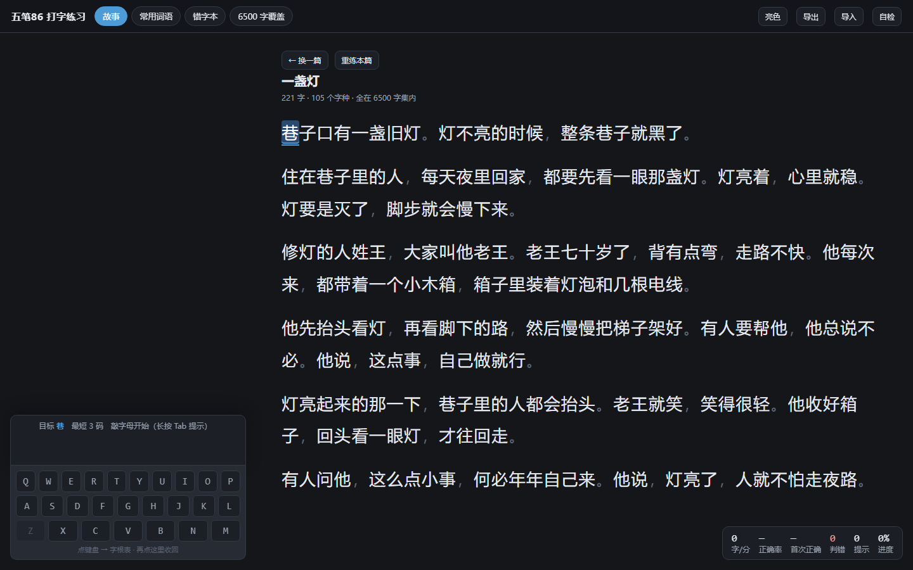
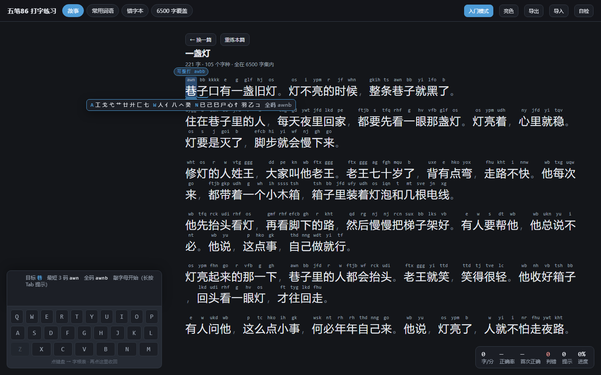
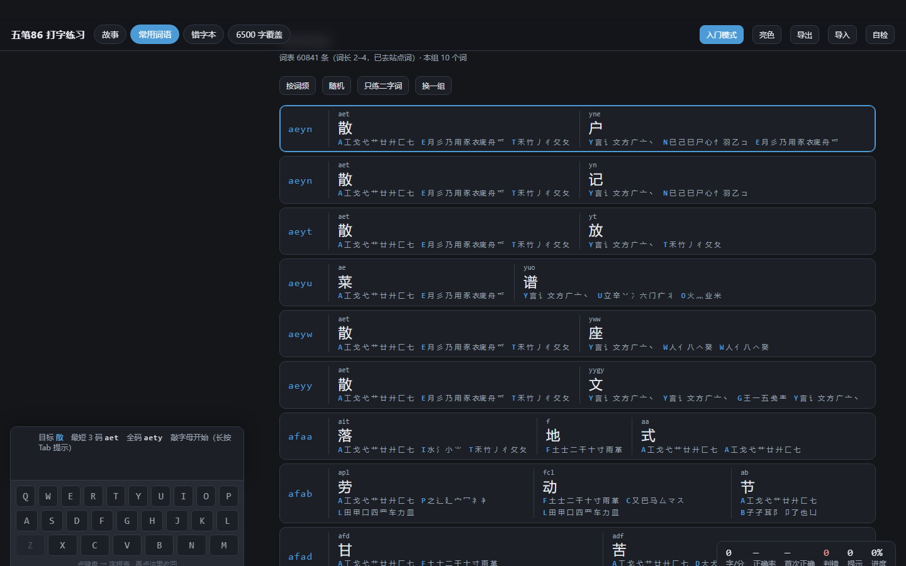
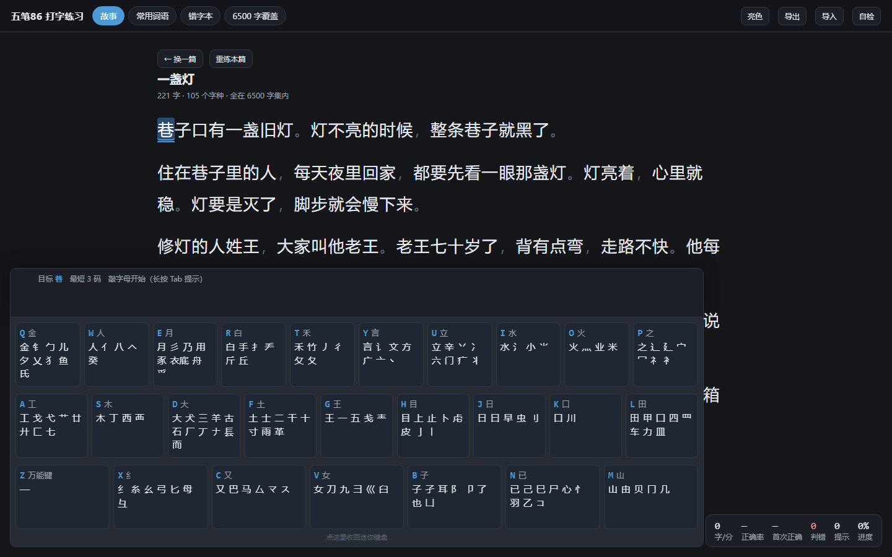
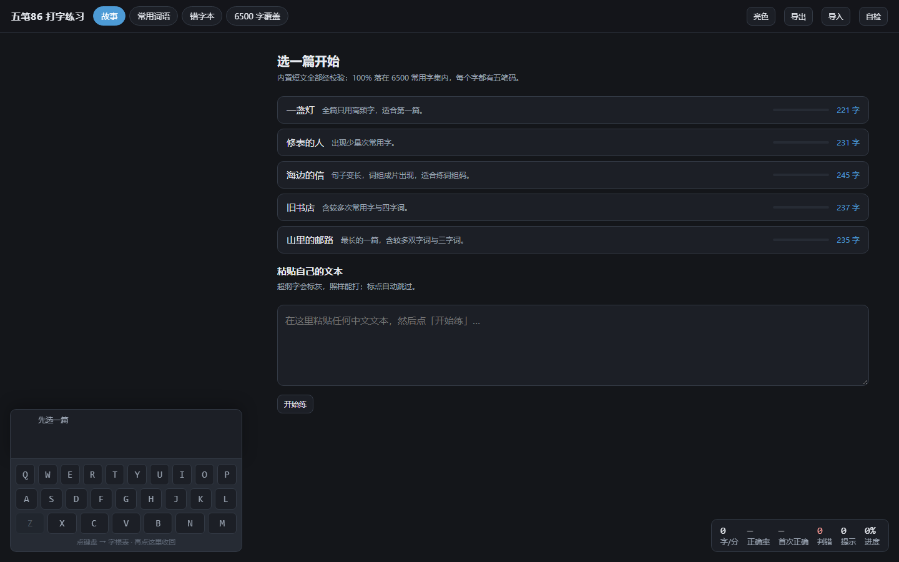

# 五笔86 打字练习器

以故事为蓝本的五笔 86 打字练习器。纯静态 web app，**无框架、零构建，双击 `index.html` 就能用**（离线，进度存本地）。



## 快速开始

双击 `index.html` → 点一下遮罩 → 选一篇 → 在英文输入法下敲五笔编码。

| 键 | 作用 |
|---|---|
| `a`–`z` | 敲五笔编码（`z` 是万能键，练习中判为非法并拒收） |
| `空格` | 选第 1 个候选 |
| `1`–`9` | 选本页第 N 个候选 |
| `-` `=` | 上/下翻页（每页 9 个） |
| `Tab` 长按 0.35 秒 | 提示目标字还缺哪几个字母，并给出可整打的词码 |
| `退格` | 缓冲非空删一码；缓冲空则撤销上一个正确上屏 |
| `Esc` | 清空缓冲（字根表展开时则收回键盘） |
| 点左下键盘 | 迷你键盘 ⇄ 86 版 25 键字根表（原地放大，打字时实时高亮当前键） |

四种模式：**故事**（内置 5 篇 + 粘贴自己的文本）· **常用词语**（词组码整打）· **错字本**（错过的字/词集中重练）· **6500 字覆盖**（热力图，点任意字开始刷字表）。

## 入门模式（默认开）

右上角「入门模式」开关。打开后：

- **每个字上方显示它的最短合法码**（就是"打这几个键就能上屏"的那个码），当前字的码高亮
- **当前字给字根拆解**：逐位列出「这一码在哪个键 + 该键有哪些字根」，并另外给出全码
  （例：`巷 = awn` → `A 工戈弋艹廿廾匚七　W 人亻八𠆢癸　N 已己巳尸心忄羽乙コ　全码 awnb`）
- **光标处的可整打词会被标出来**（`可整打 awbb`）—— 初学者不知道哪几个字能整打，这是词组码的入口
- **词语模式**改成「一行一个词」的参考表：词组码 + 逐字的码 + 逐字的字根拆解，一屏看完
- **判错后保留已敲的码**：初学者最常见的错法是"太早按空格"（目标是 `雨`=fghy，敲了 `fg` 就空格
  → 上屏 `二` 判错）。普通模式清空缓冲要重敲 4 个键，入门模式保留 `fg`，接着敲 `hy` 就对上了

统计上有个要紧的区分（见 `src/stats.js`）：入门模式照着答案打对，只计**练习量**（`seenBeginner`），
**不计掌握度**（`seen`）—— 否则入门模式跑一遍 6500 字，热力图就全绿了，掌握度变成谎话。
判错照常计入 `wrong`，错字本照常可用。热力图里"只在入门模式练过"的字用**斜纹**单独表示。

行距做过实测与回归（`src/selftest.js` 里有一项专门量它）：入门模式每个字多一行编码，
但原来 1.95 的行距本来就留了大量空隙，编码行正好塞进去 —— **整段总高只涨 9%**（598px vs 549px，
实测于 1440×900）。普通模式保持 `inline` 布局，与从前完全一致。

### 字根拆解的数据是分层的

| 层 | 内容 | 需要什么 |
|---|---|---|
| 默认（公开仓库自带） | 键位 + **该键的字根集合**（措辞上不承诺"就是其中某一个"） | 只需 `data/rootmap.js`，零依赖、零许可风险 |
| 精确（可选，本地生成） | **逐个码位**给出真实字根字形，并区分「字根位 / 识别码位 / 笔画码位」 | 需跑一次 `tools/fetch_rootunits.py`（数据与字体只落本地、不入库）—— **尚未实现** |

精确层的数据来自 [hantang/search-wubi](https://github.com/hantang/search-wubi)，**该仓库没有许可文件**，
字根又是私用区码点（必须配它自带的 `黑体字根.ttf` 才显示得出来），所以那份数据与字体**不能随仓库公开**。
默认层则永远合法可用。





## 一键验证

```bash
python tools/build_data.py          # 重建 data/wubi86.js + 打印/写出自检报告
node tools/test_data.js             # 数据不变式          ALL PASS
node tools/test_rootmap.js          # 字根表 vs 码表反验   ALL PASS
node tools/test_logic.js            # 状态机行为（含入门模式）ALL PASS
node tools/test_stories.js          # 内置故事校验         ALL PASS
tools\browser_check.cmd             # 浏览器自检（双击即可，headless Chrome/Edge）
```

浏览器自检也可以手动看：打开 `index.html?selftest=1`（或点界面右上角「自检」）。
它在真实浏览器里跑 **105 项**数据/逻辑/字根表/故事/界面/行距检查，全绿才写 `SELFTEST PASS`。



## 目录结构

```
五笔练习/
├─ index.html            入口
├─ src/
│  ├─ wubi-core.js       纯逻辑：倒排索引 + 输入状态机（不碰 DOM，node 可跑）
│  ├─ stats.js           localStorage 统计（字级数据 / 断点 / 历史 / 导出导入）
│  ├─ app.js             UI：四种模式 + 键盘/字根表 + 提示 + 主题
│  ├─ selftest.js        浏览器内自检（仅 ?selftest=1 时加载）
│  └─ styles.css         样式（暗色为主，可切亮色）
├─ data/
│  ├─ wubi86.js          码表（生成物，2.6 MB，勿手改）
│  ├─ rootmap.js         86 版 25 键字根表 + 助记口诀
│  └─ stories.js         内置 5 篇原创短文
├─ docs/                 截图
└─ tools/
   ├─ build_data.py      数据管线（下载/过滤/补简码/出自检报告）
   ├─ report.md          数据自检报告（生成物）
   ├─ raw/               源数据缓存（rime 码表 + 通用规范汉字表 + OpenCC 繁简表）
   ├─ test_data.js       数据不变式
   ├─ test_rootmap.js    字根表反验（用码表验证字根归属）
   ├─ test_logic.js      状态机单测（15 组约 90 条断言）
   ├─ test_stories.js    内置故事校验
   └─ browser_check.cmd  浏览器自检（headless）
```

## URL 钩子

| 参数 | 作用 |
|---|---|
| `?selftest=1` | 跑浏览器自检并把结果写进页面 |
| `?mask=0` | 跳过"点击开始"遮罩 |
| `?story=lamp` | 直接开始某篇内置故事（`lamp` `watch` `letter` `bookshop` `mailroad`） |
| `?keys=root` | 迷你键盘以字根表形态打开 |
| `?beginner=0\|1` | 强制入门模式开关的初始状态（只影响本次，不写偏好） |
| `?mode=words` | 直接进入某个模式（`story` `words` `wrong` `heat`） |

## 数据口径（实测数字，不是估计）

| 项 | 值 |
|---|---|
| 练习字集 charset | **6500** = 通用规范汉字表 一级 3500 + 二级 3000 |
| 码表覆盖 | 75020 条单字码行 / 70365 个字（含扩展 A/B），61200 条词组 |
| 缺码 | 一级+二级 里 **0** 个无码；三级里也 0 个 |
| 最短合法码长度 | 1码:25 / 2码:602 / 3码:3576 / 4码:2297 |
| 无 4 码全码的字 | 788（如 十=`fgh` 丁=`sgh` 八=`wty`） |
| 必须按数字选字的 4 码 | 185（同一码里有 ≥2 个字集内的字） |
| 自动上屏触发的叶子码 | 93083 个（3 码叶子 85，其余为 4 码） |
| 能靠自动上屏落地的字 | 2240 / 6500（其中 2237 个是 4 码） |
| 词条 | 61200（2字:48441 / 3字:4518 / 4字:7933 / 5字+:308） |
| 可用词表（词长 2–4，去站点词） | 60841 |
| 内置故事 | 5 篇 / 221–245 字，超纲 **0** 字，可用词组整打占比 51–57% |

**为什么是 6500 而不是 7000**: 国标三级字表(1605)定位为姓氏人名/地名/科技术语用字。实测按网页词频取 500
得到的全是生僻/人名/元素字（`於噂昇晖玟珺瑀琊燊`），凑 7000 无练习价值。故取国标「常用字 + 次常用字」
= 6500。码表仍保留全部汉字，粘贴文本里的超纲字照样能打（标灰提示、单独计数）。

### 词组码是可推导的（拆解词时用得到）

用**单字的最长可用码**按标准规则推导词组码（2字词=每字前两码 / 3字=前两字首码+末字前两码 /
4字及以上=前三字首码+末字首码），与码表实测 **61172/61200 = 100.0% 一致**，只有 28 条例外
（`版权所有`=bqsy 是拼音首字母误收；其余 27 条是 `蹒跚`=kakm、`踊跃`=kckt 这类双字同偏旁词，
码表用了非标准取码）。所以词的拆解可以自己算，不需要外部数据。

### 字根拆解的四项完整性校验（本地精确层）

| 校验 | 结果 |
|---|---|
| `units` 个数 == 码长 | 0 例外 |
| 末码是识别码的判定（末笔+结构 → 5×5 区位） | **2909/2909 = 100%** |
| 字根字形跨键出现（299 个字形） | **0**（每个字形只属于一个键） |
| 识别码位字形数 | 恰好 **15** 个 = 5 末笔 × 3 结构 |

**为什么必须区分识别码**：6500 个常用字里有 **2909 个（44.8%）** 的末码是末笔识别码而不是字根
（`想`=shnu：`s`木 `h`目 `n`心 是字根，`u` 是识别码）。一律当字根显示会把 45% 的字教错。
另有 25 个字根字（`十`=fgh 的 `g`/`h`）尾码是笔画码，`一`=ggll 的 `ll` 是补齐位 —— 都单独标注。

## 已锁定的输入语义

```
候选集 = 精确匹配（真五笔行为，不做前缀联想。打 fgh 不会冒出 fghy 的候选）
排序   = (是否在练习字集内, 权重降序, 字序)
         网页语料把繁体/异体排前面，实测 216 个码需要这条偏向纠正
         （如 alpu -> 蓮 压 莲），字集内字最差排第 4 位，所以截断 9 个仍够用
按键   = a-z。`缓冲+字母` 是合法码或合法前缀 -> 入缓冲；否则拒收 + 闪红 + 计错
自动上屏 = 缓冲码是叶子码（无更长码以它为前缀）且首选唯一
         都=ftjb 唯一 -> 自动上屏；十=fgh 有 fghy -> 不自动；雨=fghy 有 4 个候选 -> 不自动
翻页   = 每页 9 个，- / =。这一条是实测逼出来的：811 个扩展B 超纲字最好名次在
         10–44 位，不翻页在严格模式下就是死路
标点   = 显示但自动跳过（不入 plan）
严格   = 上屏内容 !== 目标切片 -> 判错、光标不动
         缓冲清空（非入门）/ 保留（入门，治"太早按空格"）
```

引擎只**报告**判对结果（事件里的 `correct`），不替上层决定要不要放行 —— 以后要加「流畅模式」不用改引擎。
`preserveBufferOnError` 是会话上可改的属性（`session.keepBuffer`），用户中途切开关不用重建会话。

## 三个必须知道的实现约束

1. **`file://` 会拦 ES module 和 `fetch`**（origin 为 `null`）。所以文件组织是：经典 `<script>` 标签 +
   数据落成 `data/wubi86.js`（`window.WUBI86 = {...}`）。这是「双击即用」的唯一可行解。
   （实测：`file://` 下 `localStorage` 可用，所以进度能存。）
2. **字集含扩展 A/B 汉字**（`㧐㧝䏝𬉼𠳐` 等 11 个字在规范表二级里）。扩展 B 在 JS 里是代理对，
   文本遍历**一律用 `Array.from()` / `for...of`**，禁止 `str.length` / `str.split("")` / `str[i]`。
   状态机、UI、单测都已按此实现并钉住。
3. **左下 dock 是固定浮层**。宽屏（≥1200px）下正文列整体右移到键盘右侧，两者互不遮挡；
   展开字根表时用"安全带"滚动把当前字压到视口上方 24% 处，永远在键盘之上。

## 需要人工核对的一处

`data/rootmap.js` 里**能独立成字的字根已用码表自动反验**（字根字的首码必须等于所在键，25 个键名字
全部通过）。剩 5 个只能作偏旁的无法自动验证，请对着字根表图片核一眼：

```
D:ナ    I:⺌    N:コ    C:マ    C:ス
```

另有 3 个偏旁例外已在数据里显式声明（`革`=F、`羊`=D、`舟`=E：作偏旁归本键，独立成字时按自身拆分取码，
如 革=`afj`、羊=`udj`、舟=`tei`），这不是错误。写这套字根表时正是靠这条反验抓出 7 处错
（`二` 属 F 不属 G、`丨` 属 H、`圭`/`灬`/`亚` 是合成字不是字根）。

## 已知可改进

- 权重来自网页语料（Chrome/Google 词频），偏网页文本。已用停用词表剔除站点导航词
  （本站/首页/最新/查看/搜索/版权…），但排序仍受语料影响（如 `嘉` 排在 `喜` 前）。
- 字根表只做了结构反验，未逐字对着权威字根图核。
- 未做移动端适配（按共识以桌面为主，迷你键盘可点击只是顺带兼容触摸）。
- **入门模式里"错字本重练 / 字表练习"没有做逐字全显**：这两个场景是 30–40 个孤立字，
  做成"每个字一张带字根的小卡"会排出 700px 高、大半是空白的卡片墙。现在它们和故事模式
  一样是"每个字显码 + 当前字给拆解"。信息一点没少，只是按需出现。想改成卡片墙就说一声。
- 精确字根拆解层（`tools/fetch_rootunits.py`）尚未动手 —— 默认层先验证。

## 许可

**GNU Lesser General Public License v3.0（LGPL-3.0）**

- [LICENSE](LICENSE) —— LGPL-3.0 原文
- [LICENSE.GPL-3.0.txt](LICENSE.GPL-3.0.txt) —— 它援引的 GPL-3.0 原文

```
Copyright (C) 2026 倪鹏生

本程序是自由软件：你可以依据自由软件基金会发布的 GNU 宽通用公共许可证
（第 3 版，或你选择的任何更新版本）条款重新发布和/或修改它。
本程序基于"有用"的期望分发，但不提供任何担保。
```

> **为什么是 LGPL 而不是 MIT**：`data/wubi86.js` 是 [rime/rime-wubi](https://github.com/rime/rime-wubi)
> （LGPL-3.0）码表的派生数据，而它占了仓库绝大部分体积、也是这个软件真正的价值所在。
> 派生数据的许可不能比上游更宽松，所以整仓统一用 LGPL-3.0，不做"代码宽松 / 数据严格"的拆分。
> 第三方来源、用途与各自许可见 [THIRD-PARTY-NOTICES.md](THIRD-PARTY-NOTICES.md)。


